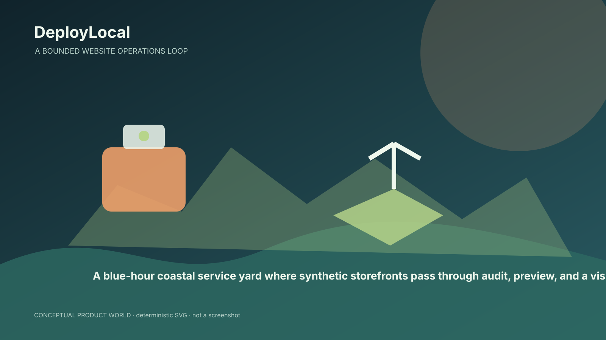
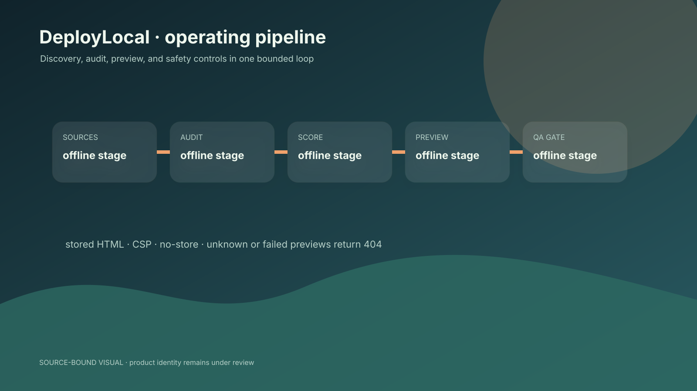
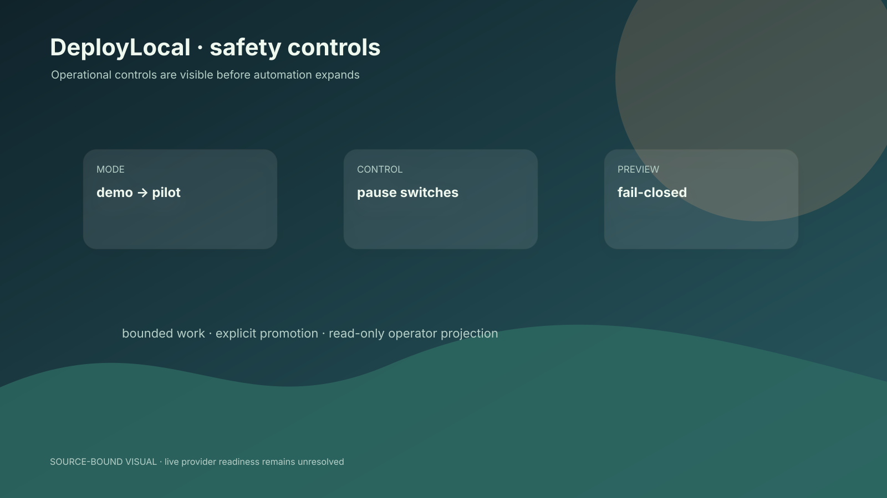

# DeployLocal

> A bounded website operations loop for finding, evaluating, previewing, and fulfilling local-business web work.

A working-tree system for local-business prospect discovery, website auditing, stored preview generation, outreach controls, checkout, fulfillment, and revenue operations; the product identity remains unresolved against SiteCloser.

[NOAERTH](https://www.noaerth.com)



## Read this repository as two snapshots

The current working tree contains a substantial SiteCloser-style prospecting, preview, outreach, checkout, fulfillment, revenue, and operator-TUI system. Committed history and the public repository still reflect an older DeployLocal lead/site-generation application. `PRODUCT_DIRECTION_DECISION.md` leaves that identity fork open. This README describes the verified working-tree direction without pretending it is a clean release.



## Verified operating loop

```text
sources → normalize/dedupe → audit → score → WebsiteSpec → stored HTML → fail-closed QA → preview/outreach → checkout → fulfillment
```

Stored HTML previews are served through a dedicated route with QA/no-store/CSP/robots controls. Revenue code models explicit offer acceptance, server-derived prices, idempotent provider events, deposit/full-payment boundaries, and bounded controller modes. These are source claims; live providers were not exercised.

## Operator safety



The controller modes are `demo`, `shadow`, `pilot`, and `autonomous`, with persisted pause switches for discovery, generation, outreach, purchases, and fulfillment. The TUI is designed as a read-only domain projection and tests assert that it does not start workers or send mail.

## Evaluation commands

```bash
`pnpm install`
`pnpm test`
`pnpm dev`
```

The local repository includes synthetic weak/strong/parked website fixtures for offline evaluation. No production revenue, conversion, deliverability, customer, or provider metric is claimed here.

## Evidence snapshot

| Evidence | Interpretation |
|---|---|
| 4 documented operating modes | Source-backed; see `v4/VERIFIED_METRICS.json` for definition and status. |
| 5 local synthetic website fixtures | Source-backed; see `v4/VERIFIED_METRICS.json` for definition and status. |
| 1 stored preview route serving QA-approved HTML | Source-backed; see `v4/VERIFIED_METRICS.json` for definition and status. |

## Limits and release boundary

- Product identity and clean release boundary remain unresolved.
- Live providers, revenue, deliverability, and domain operations were not verified.
- Legal/compliance review remains open.

## Source map

- `src/sources`
- `src/audit`
- `src/render`
- `src/app/p/[slug]/route.ts`
- `src/revenue/controller.ts`
- `tests/revenue-loop.test.ts`

## Status

Working-tree prototype under active reconstruction. Resolve the DeployLocal/SiteCloser product decision and commit boundary before calling this a stable public product.
